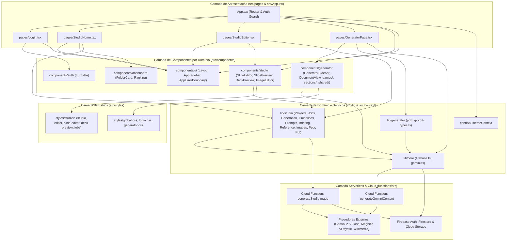
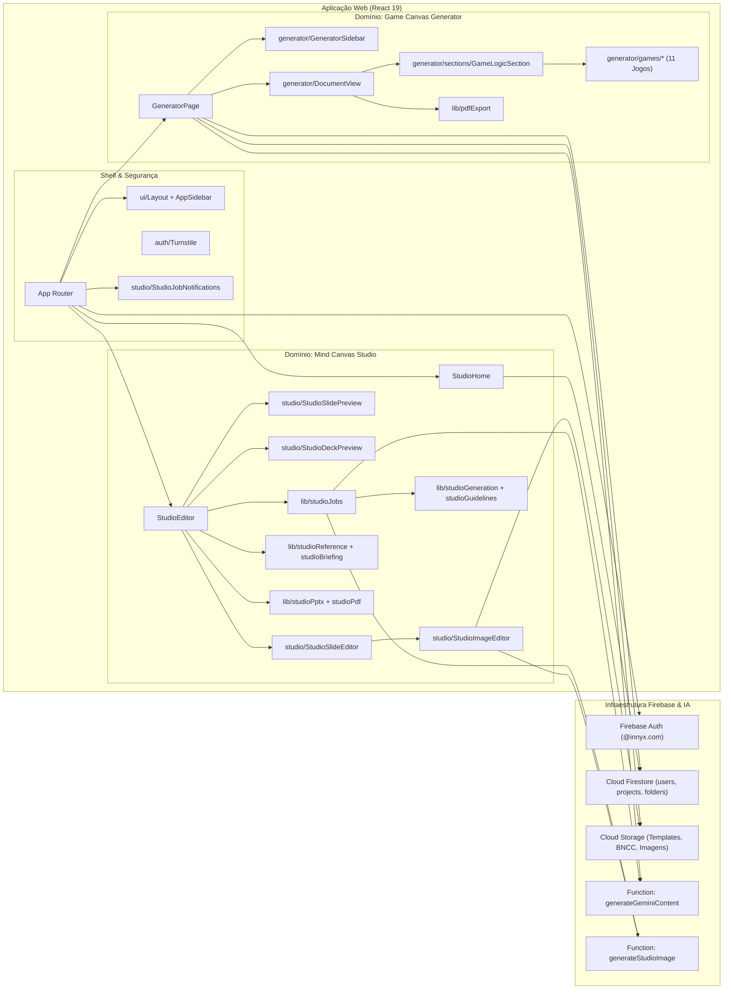
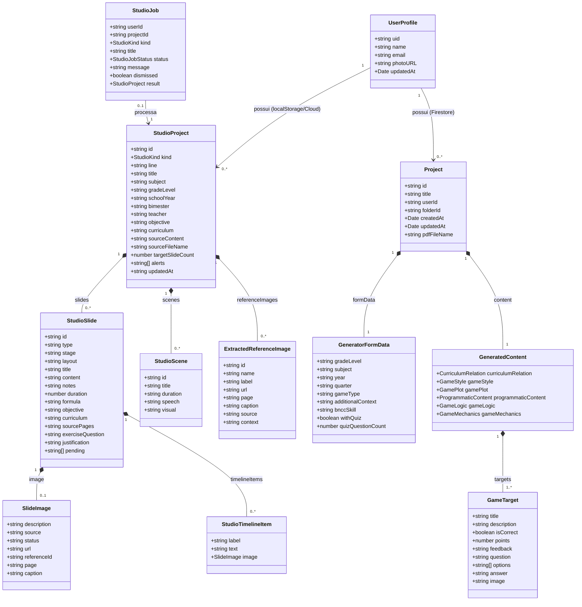
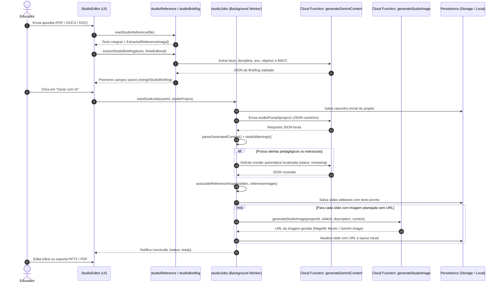
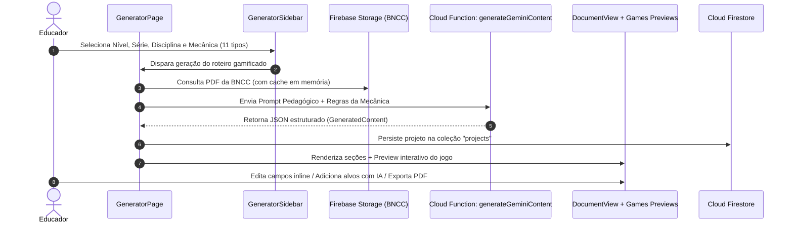

# Arquitetura e Modelagem UML — INNYX Mind Canvas & Game Canvas

Este documento consolida a **arquitetura de software**, a **organização de pastas por pacotes/camadas** e a **modelagem UML** completa do ecossistema **INNYX Mind Canvas & Game Canvas**, garantindo alinhamento e coerência entre todos os módulos do projeto.

---

## 1. Visão Geral da Arquitetura em Camadas

O projeto adota uma **Arquitetura Modular Orientada a Domínios em Camadas (Layered Domain-Driven Frontend + Serverless Backend)**, dividida em dois domínios funcionais principais que compartilham o mesmo shell visual, autenticação e infraestrutura:

1. **Mind Canvas Studio (`studio`)**: Planejamento e geração assistida por IA de **Slides Didáticos**, **Roteiros de Gravação** e **Pacotes de Aula** (Linhas *Konecta Kids*, *Konectar.me* e *Educação Corporativa*), com extração de briefing a partir de apostilas (PDF/DOC/DOCX), geração e curadoria de imagens (Magnific AI Mystic, Gemini Image, Wikimedia Commons e acervo do material) e exportação nativa para **PPTX editável** e **PDF**.
2. **Game Canvas Generator (`generator`)**: Criação e edição interativa de **Roteiros de Jogos Educacionais Gamificados** alinhados à BNCC, suportando 11 mecânicas interativas (*Quiz*, *Roleta*, *Tabuleiro*, *Memória*, *Plataforma 2D*, *Tiro ao Alvo*, *Quebra-Cabeça*, *Sliding Puzzle*, *Jogo da Velha*, *Arrastar e Soltar* e *Esmaga Palavras*).

---

## 2. Estrutura de Diretórios Alinhada aos Pacotes UML

```text
Canvas-Gamificado-main/
├── docs/                                   # Documentação Arquitetural e Diagramas UML
│   └── ARQUITETURA_UML.md                  # Especificação UML completa do projeto
├── functions/                              # [Backend Serverless] Firebase Cloud Functions v2
│   └── src/
│       ├── index.ts                        # Gateway seguro Gemini (generateGeminiContent, listStorageFiles)
│       └── studioImage.ts                  # Geração de imagens IA (Magnific Mystic + Gemini Image) + Storage
├── public/                                 # Assets estáticos e Templates PPTX oficiais
│   └── templates/                          # Matrizes .pptx e capas (Konecta Kids, Konectar.me, Corporativo)
├── scripts/                                # Scripts utilitários e de diagnóstico de infraestrutura
│   └── check_storage.js                    # Verificador de buckets do Firebase Storage
├── src/                                    # [Frontend Application] React 19 + TypeScript + Vite
│   ├── App.tsx                             # Roteador principal, guardas de sessão (@innyx.com) e providers
│   ├── main.tsx                            # Ponto de entrada (Bootstrap React DOM)
│   ├── types.ts                            # Contratos e entidades de domínio do Game Canvas
│   ├── context/                            # [Package: context] Estado Global Transversal
│   │   └── ThemeContext.tsx                # Provedor de tema claro/escuro
│   ├── pages/                              # [Package: pages] Camada de Visão / Containers de Rota
│   │   ├── index.ts                        # Barrel export das páginas
│   │   ├── Login.tsx                       # Autenticação Google + Cloudflare Turnstile
│   │   ├── StudioHome.tsx                  # Hub unificado (Início, Meus Projetos, Modelos, Ranking)
│   │   ├── StudioEditor.tsx                # Workspace de edição de Slides, Roteiro e Pacote
│   │   ├── GeneratorPage.tsx               # Workspace de geração e edição de Jogos Educativos
│   │   └── meus-roteiros.tsx               # Gerenciador legado de pastas e roteiros
│   ├── components/                         # [Package: components] Camada de Componentes por Domínio
│   │   ├── index.ts                        # Barrel export geral de componentes
│   │   ├── auth/                           # Subpacote de Autenticação e Segurança
│   │   │   ├── index.ts
│   │   │   └── Turnstile.tsx               # Widget Cloudflare Turnstile anti-bot
│   │   ├── ui/                             # Subpacote de Design System & Layout Shell
│   │   │   ├── index.ts
│   │   │   ├── Layout.tsx                  # Shell estrutural com barra lateral e área de conteúdo
│   │   │   ├── AppSidebar.tsx              # Navegação lateral responsiva e colapsável
│   │   │   ├── AppErrorBoundary.tsx        # Tratamento global de falhas de renderização
│   │   │   ├── Card.tsx                    # Card de projeto
│   │   │   ├── CustomSelect.tsx            # Seletor customizado acessível
│   │   │   ├── LoadingAnimation.tsx        # Animações de carregamento
│   │   │   ├── LoginFlowBackground.tsx     # Background visual da tela de login
│   │   │   ├── JoystickParticles.tsx       # Efeitos visuais interativos
│   │   │   └── ThreeBackground.tsx         # Cena 3D em Three.js
│   │   ├── studio/                         # Subpacote do Domínio Mind Canvas Studio
│   │   │   ├── index.ts
│   │   │   ├── StudioSlideEditor.tsx       # Editor estruturado por slide e categoria pedagógica
│   │   │   ├── StudioSlidePreview.tsx      # Renderizador fiel ao template oficial + edição inline
│   │   │   ├── StudioDeckPreview.tsx       # Apresentação em tela cheia com notas do apresentador
│   │   │   ├── StudioImageEditor.tsx       # Estúdio visual (Magnific IA, Acervo PDF/DOCX e Upload)
│   │   │   ├── StudioResendModal.tsx       # Modal de reenvio/atualização de material de referência
│   │   │   └── StudioJobNotifications.tsx  # Toast global de acompanhamento de jobs assíncronos
│   │   ├── generator/                      # Subpacote do Domínio Game Canvas Generator
│   │   │   ├── index.ts
│   │   │   ├── GeneratorSidebar.tsx        # Formulário de parâmetros pedagógicos e upload BNCC/PDF
│   │   │   ├── DocumentView.tsx            # Visualizador e editor completo do documento de jogo
│   │   │   ├── games/                      # 11 Previews e editores específicos por mecânica de jogo
│   │   │   │   └── index.ts
│   │   │   ├── sections/                   # Seções modulares do Canvas (Lógica, Mecânicas, Imagens)
│   │   │   │   └── index.ts
│   │   │   └── shared/                     # Primitivos compartilhados do gerador (Field, SectionCard, etc.)
│   │   │       └── index.ts
│   │   └── dashboard/                      # Subpacote de Organização de Pastas e Gamificação Docente
│   │       ├── index.ts
│   │       ├── FolderCard.tsx              # Card de pasta com suporte a drag-and-drop
│   │       ├── folderConfig.ts             # Paleta e configuração de pastas
│   │       └── Ranking.tsx                 # Painel e modal de ranking de produção de educadores
│   ├── lib/                                # [Package: lib] Camada de Serviços, Domínio e Infraestrutura
│   │   ├── index.ts                        # Barrel export unificado da camada de serviços
│   │   ├── core/                           # Subpacote de Infraestrutura Base (Firebase + Gemini)
│   │   │   └── index.ts
│   │   ├── studio/                         # Subpacote de Serviços do Mind Canvas Studio
│   │   │   └── index.ts
│   │   ├── generator/                      # Subpacote de Serviços do Game Canvas Generator
│   │   │   └── index.ts
│   │   ├── firebase.ts                     # Inicialização Firebase (Auth, Firestore, Storage, Functions)
│   │   ├── gemini.ts                       # Adaptador seguro IA (Cloud Function + fallback local)
│   │   ├── pdfExport.ts                    # Exportador PDF com snapshot de layout para o Game Canvas
│   │   ├── studioProjects.ts               # Entidades e persistência de projetos do Studio
│   │   ├── studioJobs.ts                   # Orquestrador de jobs assíncronos, fila, retry e matching de imagens
│   │   ├── studioGeneration.ts             # Parser, normalizador e validador do JSON canônico de aulas
│   │   ├── studioGuidelines.ts             # Regras editoriais, durações, tipos de slide e checklist
│   │   ├── studioPrompts.ts                # Engenharia de prompts modulares por linha editorial
│   │   ├── studioBriefing.ts               # Extrator automático de briefing e normalizador BNCC
│   │   ├── studioReference.ts              # Leitor de documentos PDF, DOCX e DOC binário (OLE2)
│   │   ├── studioImages.ts                 # Cliente de geração (Magnific/Gemini), upscale e upload de imagens
│   │   ├── studioWebImages.ts              # Busca de imagens em domínio público (Wikimedia Commons)
│   │   ├── studioNavigation.ts             # Ordenação canônica de slides, categorias e permissões master
│   │   ├── studioPptx.ts                   # Motor OpenXML (JSZip + DOMParser) de exportação PPTX nativo
│   │   └── studioPdf.tsx                   # Motor de exportação PDF de alta resolução para slides
│   └── styles/                             # [Package: styles] Folhas de Estilo Modulares
│       ├── global.css                      # Tokens globais e configuração Tailwind v4
│       ├── login.css                       # Estilos da jornada de login
│       ├── generator.css                   # Estilos do Game Canvas Generator
│       └── studio/                         # Subpasta de estilos do Mind Canvas Studio
│           ├── studio.css                  # Shell principal, sidebar e tela inicial
│           ├── studio-editor.css           # Editor de aulas e painéis de configuração
│           ├── studio-slide-editor.css     # Editor detalhado de slide
│           ├── studio-deck-preview.css     # Frames de slide 16:9 e apresentação fullscreen
│           └── studio-jobs.css             # Notificações flutuantes de jobs em segundo plano
├── tests/                                  # Suíte automatizada de testes unitários e de integração (Node Test)
└── tools/mind-canvas/                      # Regras de negócio, exemplos canônicos e referências pedagógicas
```

---

## 3. Diagrama de Pacotes UML (Package Diagram)

O diagrama abaixo representa a organização estrutural em pacotes e as relações de dependência unidirecionais (`Presentation -> Components -> Services/Domain -> Infrastructure/Backend`):



---

## 4. Diagrama de Componentes UML (Component Diagram)

Este diagrama detalha como os componentes internos dos dois domínios (**Mind Canvas Studio** e **Game Canvas Generator**) se conectam aos serviços de domínio e às integrações externas:



---

## 5. Diagrama de Classes e Domínio UML (Class Diagram)

Modelagem completa das entidades de dados, agregados e serviços principais do sistema (`src/types.ts`, `src/lib/studioProjects.ts`, `src/lib/studioJobs.ts` e `src/lib/studioBriefing.ts`):



---

## 6. Diagramas de Sequência UML (Sequence Diagrams)

### 6.1. Fluxo de Geração Assíncrona de Aulas e Imagens (Mind Canvas Studio)



### 6.2. Fluxo de Geração de Jogos Educativos (Game Canvas Generator)



---

## 7. Diagrama de Estados UML (State Diagram) — Ciclo de Vida do `StudioJob`

```mermaid
stateDiagram-v2
  [*] --> Rascunho: Criação ou importação de PDF/DOCX
  Rascunho --> Generating: startStudioJob()
  Generating --> Reviewing: JSON válido, mas com alertas no checklist
  Generating --> AssociatingImages: JSON 100% aderente ao checklist
  Generating --> Repairing: Falha de sintaxe JSON na 1ª tentativa
  Repairing --> AssociatingImages: Reparo bem-sucedido
  Repairing --> Error: Falha persistente ou Timeout (130s)
  Reviewing --> AssociatingImages: Revisão concluída ou Timeout de revisão (45s)
  AssociatingImages --> GeneratingAIImages: Imagens do PDF associadas; restam imagens IA
  AssociatingImages --> Ready: Todas as imagens resolvidas
  GeneratingAIImages --> Ready: Imagens geradas e salvas no Storage
  Error --> Generating: Tentativa de reenvio (Retry)
  Ready --> [*]
```



---

## 8. Matriz de Coerência e Responsabilidades por Pasta

| Pacote / Diretório | Camada Arquitetural | Responsabilidade Única (SRP) | Principais Módulos |
| :--- | :--- | :--- | :--- |
| `src/pages/` | **Apresentação (Views)** | Orquestrar rotas, estado de página e conectar componentes aos serviços. | `Login.tsx`, `StudioHome.tsx`, `StudioEditor.tsx`, `GeneratorPage.tsx` |
| `src/components/ui/` | **Design System / Shell** | Fornecer layout base, navegação lateral, limites de erro e componentes visuais puros. | `Layout.tsx`, `AppSidebar.tsx`, `AppErrorBoundary.tsx`, `Card.tsx` |
| `src/components/auth/` | **Segurança (UI)** | Encapsular widgets de verificação e proteção de login. | `Turnstile.tsx` |
| `src/components/studio/` | **Domínio UI: Studio** | Renderizar e editar slides, cenas, imagens e apresentações do Mind Canvas. | `StudioSlideEditor.tsx`, `StudioSlidePreview.tsx`, `StudioImageEditor.tsx`, `StudioDeckPreview.tsx` |
| `src/components/generator/` | **Domínio UI: Generator** | Renderizar o Canvas de jogos educativos e os 11 simuladores interativos. | `DocumentView.tsx`, `GeneratorSidebar.tsx`, `games/*`, `sections/*`, `shared/*` |
| `src/components/dashboard/` | **Domínio UI: Dashboard** | Exibir organização em pastas e ranking gamificado de educadores. | `FolderCard.tsx`, `Ranking.tsx`, `folderConfig.ts` |
| `src/lib/core/` | **Infraestrutura Cliente** | Gerenciar conexões com Firebase e adaptador seguro do Gemini. | `firebase.ts`, `gemini.ts` |
| `src/lib/studio/` | **Domínio & Serviços: Studio** | Regras de negócio, geração de slides, leitura de PDF/DOCX, jobs e exportação PPTX/PDF. | `studioProjects.ts`, `studioJobs.ts`, `studioGeneration.ts`, `studioPptx.ts`, `studioPdf.tsx`, `studioImages.ts` |
| `src/lib/generator/` | **Domínio & Serviços: Generator** | Serviços de exportação documental do gerador de jogos. | `pdfExport.ts` |
| `src/styles/` | **Estilização Modular** | Separar estilos globais, estilos do gerador e subpacote `styles/studio/`. | `global.css`, `login.css`, `generator.css`, `studio/*.css` |
| `functions/src/` | **Backend Serverless** | Proteger chaves de API (Gemini/Magnific) e persistir imagens geradas no Storage. | `index.ts`, `studioImage.ts` |
| `tests/` | **Qualidade & Contratos** | Garantir regressão zero nas regras de parsing, PPTX, imagens, briefing e jobs. | `studio*.test.mjs` |

